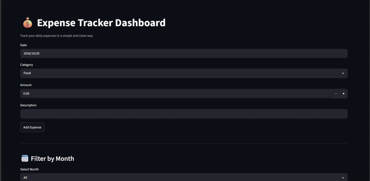
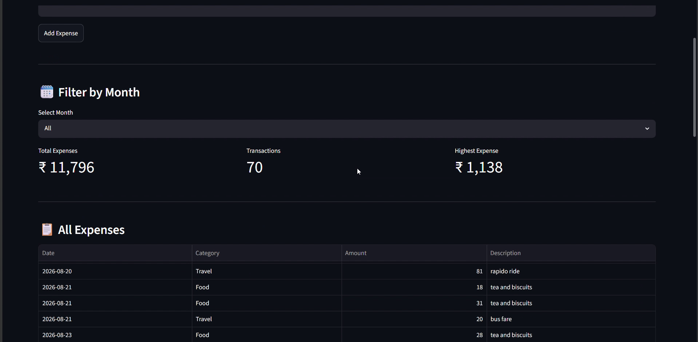
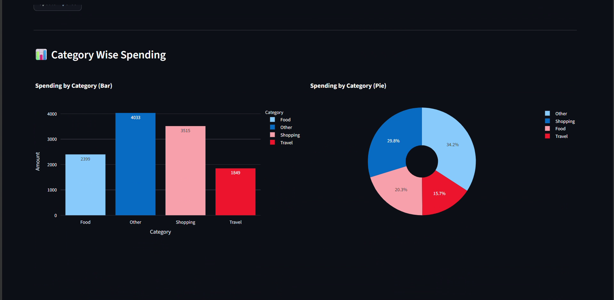

# 💸 Expense Tracker

A simple Streamlit web app to record, manage and visualize daily expenses.



## ✨ Features
- ➕ Add, ✏️ edit and 🗑️ delete expenses
- 📅 Filter expenses by month
- 📊 Summary cards: total expenses, number of transactions, highest expense
- 📋 View all expenses in a table
- 🥧 Category-wise spending (bar + pie charts)
- ⬇️ Download expenses as CSV

## 🛠️ Tech Stack
Python · Streamlit · Pandas · Plotly

## 🚀 Run Locally
```bash
git clone https://github.com/<your-username>/expense-tracker.git
cd expense-tracker
pip install -r requirements.txt
streamlit run app.py
```
Then open http://localhost:8501 in your browser.

> 💡 On first run the app creates an empty `expenses.csv` automatically. To try it with demo data, copy `sample_data.csv` to `expenses.csv` before running.

## 📸 Screenshots
| Dashboard | Charts |
|-----------|--------|
|  |  |

## 📂 Data
`sample_data.csv` contains dummy data for demo purposes. Your own entries are saved locally and are not uploaded to GitHub.

## 🔮 Future Improvements
- Monthly spending trend chart
- Budget limit alerts
- Date range filter

## 👩‍💻 Author
**Mahalakshmi** — Final-year B.Tech AI & Data Science
[LinkedIn](<your-linkedin-link>)
